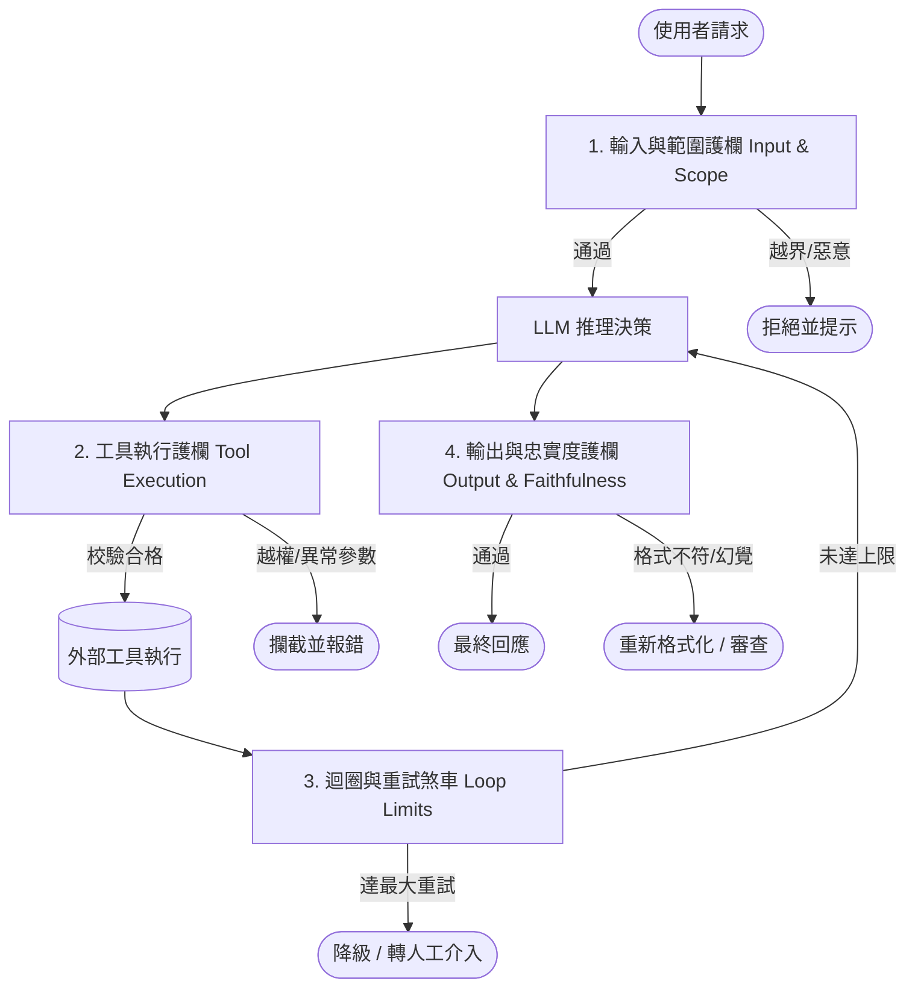

# 安全護欄與評測體系 (Guardrails & Evals)

## 1. 核心區隔：執行期防護 vs 離線品質衡量

在構建可靠的企業級 AI Agent 時，許多開發者常將「護欄（Guardrails）」與「評測（Evals）」混為一談。二者在時間軸與職能上有本質區別：

* **Guardrails（執行期硬防護）**：部署在系統執行階段（Runtime）的確定性程式碼邏輯與過濾機制。其核心目標是**即時攔截**危險行為、格式偏差、越權操作與死循環，確保錯誤「絕不在終端使用者面前發生」。（來源：[Arize 護欄與評估指南](../sources/05_ai_agent_guardrails_vs_evals.md)）
* **Evals（離線／非同步品質評估）**：在測試集或非同步日誌上執行的品質指標體系。其核心目標是**客觀量測**任務完成率、工具呼叫準確率與推理忠實度，作為系統提示詞優化與架構迭代的指南針。（來源：[Arize 護欄與評估指南](../sources/05_ai_agent_guardrails_vs_evals.md)）

---

## 2. 構建 Guardrails 的四大維度

### 2.1 輸入與範圍護欄（Input & Scope Guardrails）
* **範圍邊界（Scope Checking）**：過濾與業務無關的提問。當使用者提出超出權責範圍的要求時，主動表明職責並禮貌拒絕，而非勉強猜測。（來源：[Arize 護欄與評估指南](../sources/05_ai_agent_guardrails_vs_evals.md)）
* **安全分類與防注入**：過濾惡意 Prompt Injection 與 PII（個人敏感資訊）過濾與遮罩。（來源：[OpenAI 實務指南](../sources/01_openai_practical_guide.md)）

### 2.2 工具執行護欄（Tool Execution Guardrails）
* **權限隔離（Permission Isolation）**：明確分離唯讀（Read）工具與寫入（Write/Action）工具。
* **參數校驗（Argument Validation）**：在呼叫真實函式前，透過 Python 驗證邏輯檢驗數值範圍（如轉帳金額上限、日期合理性）。（來源：[Arize 護欄與評估指南](../sources/05_ai_agent_guardrails_vs_evals.md)）

### 2.3 迴圈與重試煞車（Loop & Retry Limits）
* **防範工具死循環（Tool Loops）**：當工具回傳空值或報錯時，模型容易反覆以相同參數重試。必須嚴格設定單一節點最大重試次數（如 2～3 次），以及全域最大步數（`max_iterations`）。（來源：[ReAct 設計模式](../sources/04_react_agent_pattern.md)）
* **超限轉移**：達到上限即強制中斷，避免無效消耗 API 額度。（來源：[從零實作教學](../sources/02_build_ai_agent_from_scratch.md)）

### 2.4 輸出與忠實度護欄（Output Guardrails）
* **格式校驗**：驗證輸出字數、結構化 JSON 欄位是否齊全。
* **事實忠實度（Faithfulness）**：比對工具產生的 Observation，確認輸出的結論皆有事實佐證，沒有憑空幻覺。（來源：[Arize 護欄與評估指南](../sources/05_ai_agent_guardrails_vs_evals.md)）

---

## 3. 人機協作介入（Human-in-the-loop, HITL）

並非所有決策都能全自動化。OpenAI 指南強調在高風險節點必須設置人工安全閥：
1. **高影響度操作（High-stakes Actions）**：如大額退款、刪除關鍵資料庫紀錄、向公眾發布貼文等，Agent 應生成草稿並暫停，等待人類確認後方可發送。
2. **失敗降級通道**：當 Agent 觸發重試上限或自覺信心度不足時，主動無縫交接給人工客服。（來源：[OpenAI 實務指南](../sources/01_openai_practical_guide.md)）

---

## 4. 持續改進的雙向閉環（Continuous Improvement Loop）

Guardrails 與 Evals 應形成有機的反饋循環：
1. **攔截轉測試集**：線上被 Guardrails 捕捉到的異常輸入、工具調用報錯與人工修正個案，自動記錄並沉澱至日誌庫。
2. **轉化為 Evals 案例**：將上述真實踩坑案例轉化為離線評測資料集（Golden Dataset）。
3. **優化前移（Shift-left）**：透過修改 System Prompt 或在更前期的輸入階段設置驗證，從源頭根本消除問題。（來源：[Arize 護欄與評估指南](../sources/05_ai_agent_guardrails_vs_evals.md)）

---

## 5. 觀點分歧與權衡（Trade-offs / Perspectives）

### 議題：靠 Prompt 約束 vs 靠程式碼硬護欄（Code-level Guardrails）

1. **Prompt 約束派觀點**
   * **論點**：在 System Prompt 裡寫明「請務必遵守 X 規則」、「金額不得超過 1000 元」，簡單直觀，不需撰寫繁瑣的外圍程式碼。
   * **隱憂**：LLM 本質上具備隨機性，哪怕在 99% 的情況下遵守，剩下的 1% 也可能在生產環境造成災難性後果（如被越獄或因上下文過長而遺忘）。
2. **程式碼硬護欄派觀點**
   * **論點**：凡是涉及金流、權限、資料修改與迴圈控制等關鍵邏輯，一律必須由**確定性的 Python 程式碼腳本（Deterministic Code）**進行把關。（來源：[Arize 護欄與評估指南](../sources/05_ai_agent_guardrails_vs_evals.md)）
   * **權衡結論**：**「不要指望模型永遠自律，要靠程式碼施加硬約束」**。Prompt 用於引導最佳路徑，而 Guardrails 程式碼則是不可逾越的底線。
