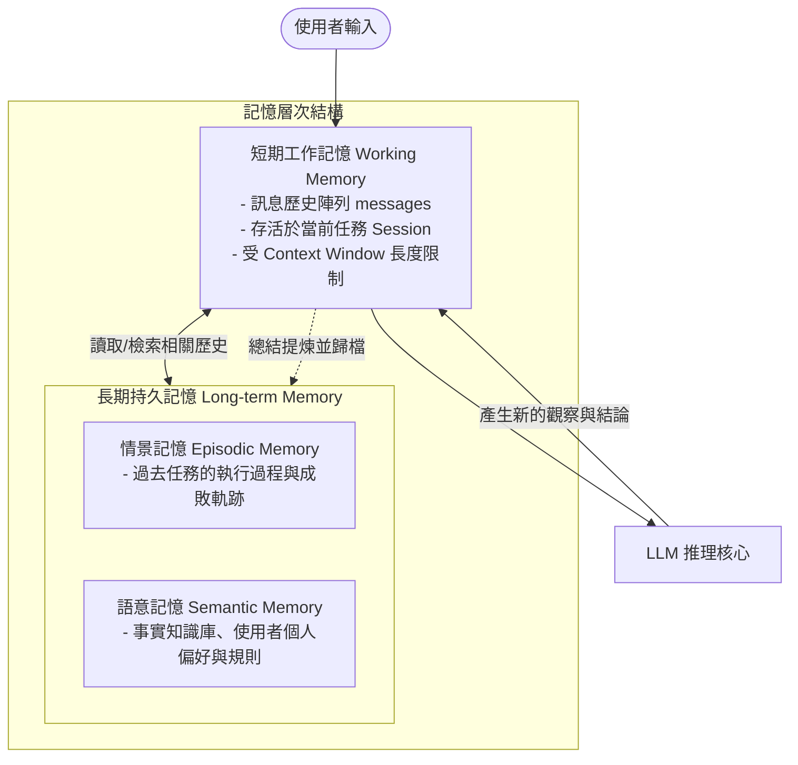

# Agent 記憶體系 (Memory Systems)

## 1. 為什麼 Agent 需要記憶？

大型語言模型本身是**無狀態（Stateless）**的——每一次與 API 的通訊都是獨立的推理請求，模型並不自帶「上一次我們聊了什麼」的內建記憶。

為了在多輪對話中保持主題一致、在多步驟任務中累積中間推論，並從過去的成功或失敗經驗中學習，Agent 架構必須外部掛載專門的**記憶體系（Memory System）**。（來源：[Agent 的解剖結構](../sources/03_anatomy_of_an_ai_agent.md)）

---

## 2. 記憶體系分層架構

在認知架構與實務系統中，Agent 的記憶主要劃分為兩大層級：

### 2.1 短期工作記憶（Short-term / Working Memory）
* **運作機制**：以 Python List 形式維護一個 `messages` 陣列，依序包含 `system`、`user`、`assistant`（包含 tool_calls）與 `tool`（工具執行回傳）角色物件。（來源：[從零實作教學](../sources/02_build_ai_agent_from_scratch.md)）
* **生命週期**：伴隨單次任務會話（Session）進行，是驅動 ReAct 迴圈中「思考 → 行動 → 觀察」即時推演的資訊載體。
* **物理限制**：受限於模型的最大 Context Window。當訊息累積過長時，不僅會帶來昂貴的 Token 成本，還可能誘發「推理漂移（Reasoning Drift）」。（來源：[ReAct 推理與行動模式](../patterns/react-pattern.md)）

### 2.2 長期持久記憶（Long-term Memory）
* **情景記憶（Episodic Memory）**：
  * 記錄過去完成任務的軌跡（例如「上次查詢訂單 #999 時物流 API 回傳失敗，需改用客服通道」）。
  * 讓 Agent 能回顧歷史決策，避免重複踩坑。（來源：[Agent 的解剖結構](../sources/03_anatomy_of_an_ai_agent.md)）
* **語意記憶（Semantic Memory）**：
  * 提煉結構化的事實事實與領域常識（例如使用者的個人稱謂、飲食偏好、業務名詞定義）。
  * 通常儲存於向量資料庫（Vector DB）或關聯式資料庫，透過語意相似度檢索（RAG）動態注入工作記憶中。（來源：[從零實作教學](../sources/02_build_ai_agent_from_scratch.md)）

---

## 3. 短期工作記憶的管理與修剪策略

在真實工程實作中，短期記憶不能無上限膨脹。常見的上下文修剪策略包括：
1. **滑動視窗（Sliding Window）**：只保留最近 $K$ 輪對話訊息，捨棄更早的歷史。
2. **對話摘要（Message Summarization）**：當 Token 數量超過閾值時，調用背景 LLM 將舊對話壓縮為一段結構化摘要，並作為新的 System 上下文。
3. **工具輸出修整（Tool Truncation）**：若工具抓回一整個萬行網頁 HTML，必須在塞回 `messages` 之前透過字串截斷或正則過濾，只保留核心資料。（來源：[安全護欄與評測體系](./guardrails-and-evals.md)）

---

## 4. 觀點分歧與權衡（Trade-offs / Perspectives）

### 議題：純短期記憶（Messages List）vs 引入長期記憶儲存庫（Vector DB）

1. **純短期記憶派主張**
   * **觀點**：對於大多數自動化工作流與即時任務，維護一個乾淨、自包含的 `messages` 陣列已經足夠。（來源：[從零實作教學](../sources/02_build_ai_agent_from_scratch.md)）
   * **優點**：架構極簡、零外部儲存相依性、沒有檢索不準確（Retrieval Failure）的風險。
2. **長效記憶派主張**
   * **觀點**：若要建構具備伴生屬性的個人助理或企業客服，缺乏長期記憶會讓 Agent 每次都像失去記憶的「金魚」，體驗極差。（來源：[Agent 的解剖結構](../sources/03_anatomy_of_an_ai_agent.md)）
   * **代價**：需維護向量檢索通道、面臨檢索雜訊干擾，以及舊記憶與新知識產生衝突時的「記憶更新（Memory Consolidation）」難題。
3. **實踐取捨指南**：
   * **第一階段**：先做好短期訊息歷史陣列的管理與修剪，掌握迴圈穩定度。
   * **第二階段**：若確實有「跨會話識別同一使用者偏好」或「累積業務歷史個案」之需求，再透過外掛資料庫引入長期記憶。
