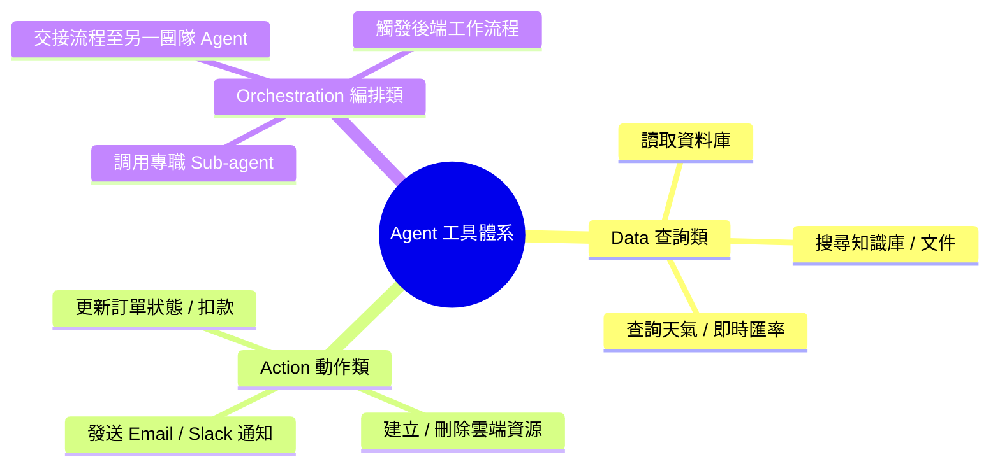

# 工具使用與註冊機制 (Tool Use & Tool Registry)

## 1. 為什麼 Agent 需要工具？

純粹的 LLM 受限於其訓練截止日與孤立的文字生成環境，無法直接感知即時世界，也無法引發實質系統變更。**工具（Tools）** 扮演了 Agent 的四肢與感官，使其能夠：
1. **獲取即時資料**：查詢資料庫、搜尋網頁、調取外部 REST API。
2. **執行精確計算**：執行 Python 程式碼、進行高精確度的數學運算與邏輯比對。
3. **對外發揮影響**：寄送電子郵件、更新 CRM 系統、修改訂單狀態。（來源：[Agent 的解剖結構](../sources/03_anatomy_of_an_ai_agent.md)）

---

## 2. 工具的三大核心分類

根據 OpenAI 實務指南，企業級 Agent 的工具可劃分為三種維度：



1. **資料查詢類（Data Tools）**：
   * 特性：通常屬於**唯讀（Read-only）** 操作，不具備破壞性副作用。
   * 風險等級：低。多數情況下可直接由 Agent 自主調用。（來源：[OpenAI 實務指南](../sources/01_openai_practical_guide.md)）
2. **動作執行類（Action Tools）**：
   * 特性：對外部系統狀態進行實質寫入、修改或刪除（Write / Mutation）。
   * 風險等級：高。通常需要搭配嚴格的權限隔離、參數驗證或 Human-in-the-loop 人工審核。（來源：[安全護欄與評測體系](./guardrails-and-evals.md)）
3. **編排類（Orchestration Tools）**：
   * 特性：將「另一個專屬 Agent」包裝為一項工具，供主控 Agent 呼叫，用以處理超出單一 Agent 認知範疇的子任務。（來源：[Agent 編排模式](../patterns/orchestration-patterns.md)）

---

## 3. 工具註冊表（Tool Registry）的架構設計

在原生實作中，為了讓 LLM 能夠精確識別並正確呼叫工具，系統必須建立一個 **工具註冊表（Tool Registry）**。註冊表負責維護兩項核心資訊：
1. **傳給模型的元資料（Metadata / Schema）**：提供給 LLM 閱讀的 JSON Schema，包含函式名稱、用途摘要及參數型別。
2. **本地可執行的函式映射（Callable Mapping）**：Python 本地的函式指標，供執行迴圈在解析出動作後直接執行。（來源：[從零實作教學](../sources/02_build_ai_agent_from_scratch.md)）

### 標準 JSON Schema 範例
```json
{
  "name": "get_weather",
  "description": "查詢指定城市的即時天氣與氣溫資訊",
  "parameters": {
    "type": "object",
    "properties": {
      "city": {
        "type": "string",
        "description": "城市名稱，例如：台北、東京"
      },
      "unit": {
        "type": "string",
        "enum": ["celsius", "fahrenheit"],
        "description": "溫標單位，預設為 celsius"
      }
    },
    "required": ["city"]
  }
}
```

---

## 4. 結構化輸出（Structured Outputs）的必要性

在原型階段，開發者常透過純文字 Prompt 要求模型輸出特定格式（例如用正則表達式解析 `Action: get_weather("台北")`）。但在正式環境中，這極易因模型的非確定性而引發解析錯誤。（來源：[從零手寫極簡 Agent 指南](../guides/minimal-agent-from-scratch.md)）

* **強制 JSON Schema 約束**：現代模型（如 OpenAI Tool Calling / Function Calling API 或 `response_format={"type": "json_object"}`）支援語法約束解碼（Grammar-constrained Decoding），保證回傳的參數 100% 符合 JSON 格式。（來源：[從零實作教學](../sources/02_build_ai_agent_from_scratch.md)）

---

## 5. 觀點分歧與權衡（Trade-offs / Perspectives）

### 議題：工具數量越豐富越好 vs 限制精簡的工具子集

1. **豐富工具派觀點**
   * **論點**：提供越多的 API 介面，Agent 的泛化適應能力與問題解決面越寬廣。
   * **代價**：當工具數量過多（如超過 20～30 個）時，LLM 容易產生「工具混淆（Tool Hallucination）」、選錯工具，或是浪費大量 Context Window 在載入未使用的 Schema 上。（來源：[OpenAI 實務指南](../sources/01_openai_practical_guide.md)）
2. **精簡工具派觀點**
   * **論點**：單一 Agent 應嚴格限制工具數量（通常建議不超過 5～8 個專用工具）。
   * **解法**：若系統業務繁雜，應透過 **[Multi-Agent 編排模式](../patterns/orchestration-patterns.md)** 將職責拆分，由不同專職 Agent 各自掌管所屬的精簡工具庫，或透過動態檢索（Tool Search）僅在需要時載入相關工具定義。
