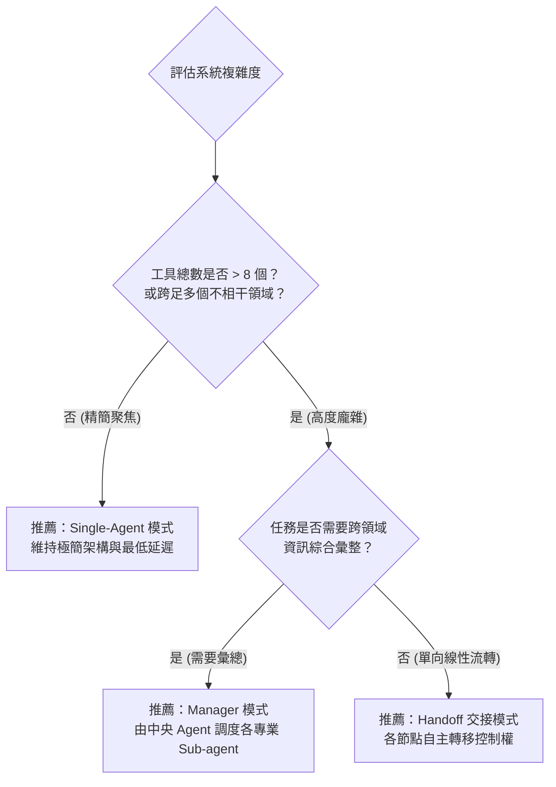

# Agent 編排模式 (Orchestration Patterns)

## 1. 什麼是 Agent 編排？

在構建具備實用價值的 Agent 應用時，單靠一個簡單的 prompt 往往不足以應對多變的業務邏輯。**編排（Orchestration）** 定義了任務如何在模型、工具以及不同專職代理之間流轉、協作與受控執行的架構模式。（來源：[OpenAI 實務指南](../sources/01_openai_practical_guide.md)）

---

## 2. 核心編排模式解析

業界主流的編排架構可劃分為兩大類：**單一 Agent 模式（Single-Agent）** 與 **多 Agent 協作模式（Multi-Agent）**。

```mermaid
flowchart TD
    subgraph SingleAgent [單一 Agent 模式 Single-Agent]
        direction TB
        SA[單一主控 Agent<br>(Model + 全量 Tools)]
        SA <--> Tools[(所有業務工具集)]
    end

    subgraph MultiAgentManager [多 Agent：管理者模式 Manager Pattern]
        direction TB
        Mgr[中央協調 Agent (Manager)]
        Mgr --> Sub1[專職 Agent A: 訂單處理]
        Mgr --> Sub2[專職 Agent B: 物流查詢]
        Mgr --> Sub3[專職 Agent C: 客訴退款]
    end

    subgraph MultiAgentHandoff [多 Agent：交接模式 Decentralized Handoff]
        direction LR
        FrontAgent[前台分流 Agent] -->|Handoff 交接| TechAgent[技術支援 Agent]
        TechAgent -->|Handoff 交接| BillingAgent[帳務處理 Agent]
    end
```

### 2.1 單一 Agent 模式（Single-Agent Pattern）
* **運作機制**：由單一 LLM 實例承載完整的 System Instructions，並掛載全部所需工具，在單一 `while` 迴圈中完成從意圖識別、工具調度到最終回覆的全部過程。
* **適用情境**：工具數量有限（5～8 個以內）、業務領域聚焦、流程長度可控的任務。（來源：[從零實作教學](../sources/02_build_ai_agent_from_scratch.md)）
* **實踐建議**：**永遠從 Single-Agent 開始打造**。過早引入多代理只會成倍增加除錯難度與延遲成本。（來源：[OpenAI 實務指南](../sources/01_openai_practical_guide.md)）

---

### 2.2 多 Agent 模式：管理者模式（Manager / Supervisor Pattern）
* **運作機制**：
  * 設立一個中央協調者（Manager / Router Agent），不直接執行具體業務工具，而是專注於分析使用者需求並將任務拆解為子目標。
  * 將專職 Sub-agents 當作工具呼叫（Orchestration Tools），由專職 Agent 各自操作所屬的資料查詢或動作工具，最後將結果回報給 Manager 進行彙整。（來源：[OpenAI 實務指南](../sources/01_openai_practical_guide.md)）
* **優點**：職責邊界清楚，子 Agent 的 System Prompt 與工具清單高度精簡，可有效降低「工具混淆」機率。

---

### 2.3 多 Agent 模式：去中心化交接模式（Decentralized / Handoff Pattern）
* **運作機制**：
  * 沒有固定不變的中央常駐指揮官，而是由多個同儕 Agent 組成協作網。
  * 當前台 Agent（例如 Welcome Agent）確認使用者問題屬於退費範疇時，直接透過 `handoff_to_billing()` 將完整的對話歷史與控制權移交給 Billing Agent，由其接管後續互動。（來源：[OpenAI 實務指南](../sources/01_openai_practical_guide.md)）
* **優點**：減少了中央 Manager 每次都要來回轉發的 Token 耗損與延遲，流程更加敏捷。

---

## 3. 編排模式選型決策樹（Decision Flowchart）



---

## 4. 觀點分歧與權衡（Trade-offs / Perspectives）

### 議題：Single-Agent 擴充 vs 盲目追求 Multi-Agent 架構

1. **熱門多代理框架（如 CrewAI / AutoGen）的推廣視角**
   * **觀點**：宣傳多代理自主對話、角色扮演（如「程式員」與「審查員」相互辯論），認為能模擬人類團隊協作並提升輸出品質。
2. **實務工程派（OpenAI 實務指南）的嚴肅警告**
   * **觀點**：多 Agent 系統會大幅提高系統不確定性、通訊 Token 開銷與端到端延遲。Agent 之間的無效社交（Chatter）極易引發無限迴圈或資訊失真。（來源：[OpenAI 實務指南](../sources/01_openai_practical_guide.md)）
   * **權衡指南**：
     * **先窮盡 Single-Agent 的潛力**：先透過優化 System Prompt、加入結構化輸出與工具精簡化來解決問題。
     * **嚴格的升級門檻**：只有在單一 Agent 的 Prompt 長度破表、工具數量導致嚴重混淆、或業務部門權限隔離（如財務與客服資料庫需硬性分立）時，才升級至 Multi-Agent 架構。
