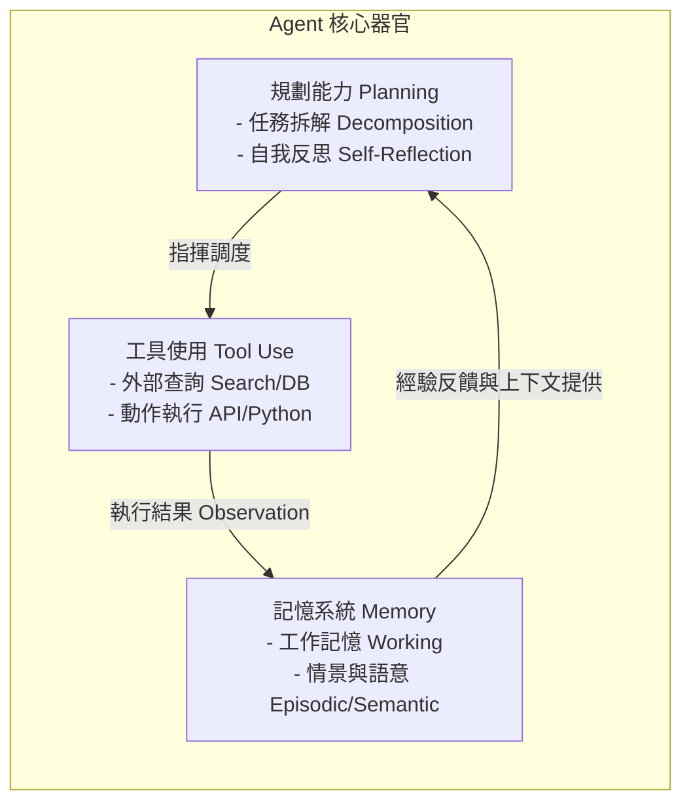

# The Anatomy of an AI Agent: Planning, Memory, and Tool Use

- **原始連結**：https://medium.com/@arunseetharaman/the-anatomy-of-an-ai-agent-planning-memory-and-tool-use-20c59985197c
- **主題分類**：核心組成拆解
- **對應原始檔**：`raw/03_anatomy_of_an_ai_agent.md`

---

## 核心論點摘要

1. **LLM 的侷限與 Agent 升級要素**
   * 單純的 LLM 本質只是「無狀態的文字機率預測器」，無法自主維持長期上下文，亦無法對真實世界產生副作用（Side Effects）。
   * 欲將 LLM 升級為能夠自主達成任務的 Agent，必須為其配置三大器官：**規劃（Planning）**、**記憶（Memory）**、**工具使用（Tool Use）**。
2. **規劃能力（Planning）**
   * **任務拆解（Task Decomposition）**：將抽象的高階目標（如「規劃三天兩夜旅遊並預訂住宿」）分解為逐步可行的子任務序列。
   * **自我反思與動態修正（Self-Reflection）**：當子任務執行失敗時（例如預訂額滿），Agent 不應直接崩潰，而是重新評估現狀並動態調整後續步驟。
3. **記憶系統（Memory）**
   * **工作記憶（Working Memory）**：即模型當前可容納的 Context Window，承載當前步驟的即時狀態與推理鏈。
   * **情景記憶（Episodic Memory）與語意記憶（Semantic Memory）**：將工具執行紀錄、過去的成功或失敗經驗結構化索引儲存，建立跨時間與跨任務的經驗累積。
4. **工具使用（Tool Use）與自我閉環**
   * 工具延伸了 LLM 的能力邊界（提供即時檢索、高精度計算與外部 API 互動）。
   * 三大器官協同運作形成閉環：**規劃決定調度工具 → 工具產生外部環境反饋 → 反饋寫入記憶 → 記憶驅動更新下一輪規劃**。

---

## 核心架構圖

---

## 貢獻與延伸概念

本篇文獻貢獻了以下 Wiki 頁面之核心論點：
* **[Agent 解剖結構與核心元件](../concepts/agent-architecture.md)**：確立了以 Planning、Memory、Tool Use 作為 Agent 三大器官之概念模型。
* **[Agent 記憶體系](../concepts/memory-systems.md)**：工作記憶（Working Memory）與情景／語意記憶（Episodic & Semantic Memory）的分類與運作機制。
* **[ReAct 推理與行動模式](../patterns/react-pattern.md)**：自我反思（Self-Reflection）與環境反饋的循環閉環。
