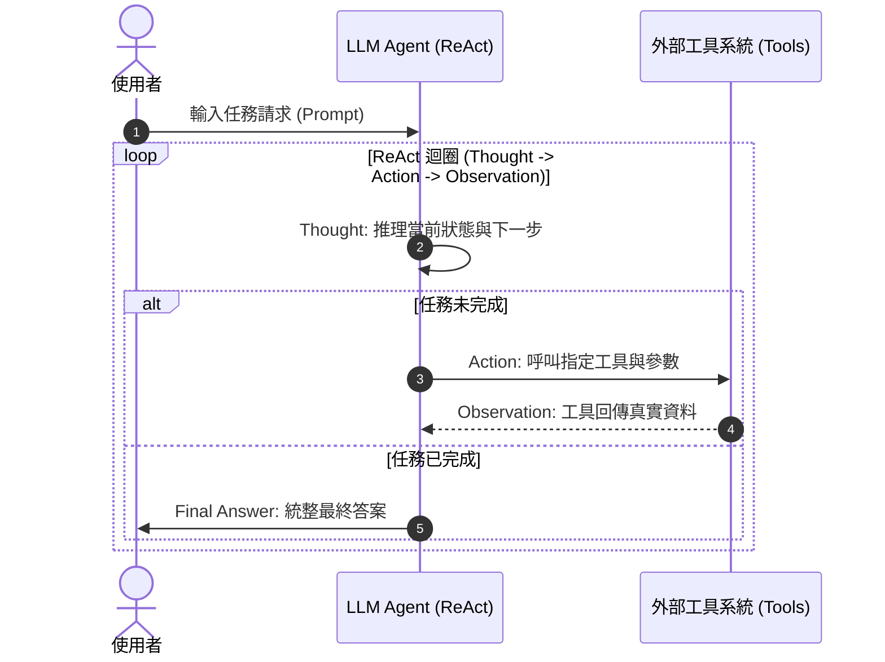

# What is the ReAct Agent Pattern? Reasoning and Acting in LLMs (Decagon)

- **原始連結**：https://decagon.ai/glossary/what-is-react-agent-pattern
- **主題分類**：推理與行動迴圈（ReAct 設計模式）
- **對應原始檔**：`raw/04_react_agent_pattern.md`

---

## 核心論點摘要

1. **ReAct 模式的定義**
   * ReAct 代表 **Reasoning（推理） + Acting（行動）**，是讓語言模型在單一架構中交替產生「內部思維軌跡（Thought）」與「外部工具調用（Action）」的經典設計模式。
2. **經典循環三步驟**
   * **Thought（思考）**：分析目標與當前已知線索，思考下一步需要向外部取得什麼資訊或執行什麼動作。
   * **Action（行動）**：選擇工具並指定精確參數（例如 `check_shipping(order_id="12345")`）。
   * **Observation（觀察）**：接收工具的實際回傳內容，作為環境反饋寫回上下文，供下一輪 Thought 參考，直到產出 `Final Answer`。
3. **三大踩坑與失效模式（Failure Modes）**
   * **工具死循環（Tool Loops）**：工具回傳空值或報錯時，模型失去除錯能力，反覆使用完全相同的參數發出請求。
   * **推理漂移（Reasoning Drift）**：上下文過長或迭代次數增加後，模型偏離最初問題核心，甚至開始幻覺編造未經證實的答案。
   * **間接提示詞注入（Indirect Prompt Injection）**：外部網頁或資料庫回傳的文字中夾帶惡意指令，劫持了模型的後續思考與動作。
4. **失效防護機制**
   * 設定最大迭代次數（Step Limit）。
   * 對外部工具回傳資料實施嚴格清洗與格式驗證。
   * 關鍵或敏感步驟加入自我檢驗或人機介入防線。

---

## 核心架構圖

---

## 貢獻與延伸概念

本篇文獻貢獻了以下 Wiki 頁面之核心論點：
* **[ReAct 推理與行動模式](../patterns/react-pattern.md)**：完整解析 ReAct 模式原理、典型對話軌跡與失效防範策略。
* **[從零手寫極簡 Agent 指南](../guides/minimal-agent-from-scratch.md)**：提供 ReAct 思考循環的具體 Python 迴圈實作依據。
* **[安全護欄與評測體系](../concepts/guardrails-and-evals.md)**：防範 Tool Loops、Reasoning Drift 與 Prompt Injection 的防護機制。
