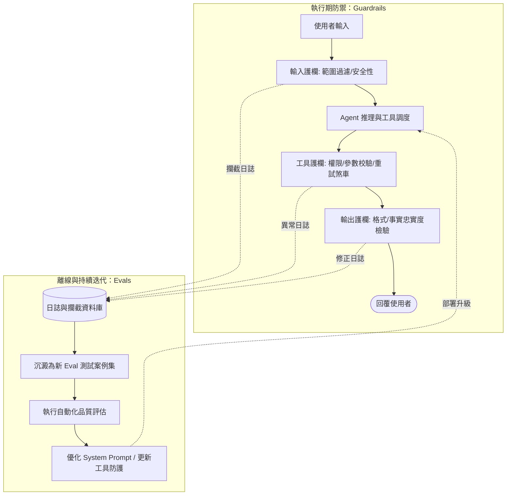

# AI Agent Guardrails vs Evals: Building Reliable Agents (Arize AI)

- **原始連結**：https://arize.com/blog/ai-agent-guardrails-vs-evals/
- **主題分類**：護欄與可靠度設計
- **對應原始檔**：`raw/05_ai_agent_guardrails_vs_evals.md`

---

## 核心論點摘要

1. **Guardrails 與 Evals 的職責邊界與定義**
   * **Guardrails（執行期即時防護網）**：在系統執行期（Runtime）以硬性程式碼邏輯進行阻斷，預防不安全、越權、幻覺或失控的動作暴露給終端使用者。
   * **Evals（評估與離線測試基準）**：在離線或非同步階段，利用基準資料集（Benchmarks）衡量 Agent 的成功率、準確度與遵循能力，作為迭代升級的羅盤。
2. **建構有效 Guardrails 的四大維度**
   * **輸入與範圍護欄（Input & Scope Guardrails）**：過濾與任務無關的提問，嚴格界定業務授權邊界，資訊不足時設定拒絕回答條款。
   * **工具執行護欄（Tool Execution Guardrails）**：在執行任何函式前進行型別校驗、金額上限確認，並落實唯讀（Read-only）與寫入（Write/Action）權限隔離。
   * **迴圈與重試煞車（Loop & Retry Limits）**：限定單一步驟或失敗節點重試次數（如 2～3 次），避免無窮死鎖。
   * **輸出與忠實度護欄（Output Guardrails）**：自動檢查格式規格（如 JSON Schema、特定長度），並比對工具回傳資料確認沒有產生非事實幻覺。
3. **持續改進的正向閉環（Continuous Improvement Loop）**
   * 線上被 Guardrails 捕捉到的異常或攔截紀錄，不應只是被動丟棄，而應結構化沉澱為新的 Evals 測試案例；透過將檢查點前移至更早的節點，降低整體系統風險。

---

## 核心架構圖

---

## 貢獻與延伸概念

本篇文獻貢獻了以下 Wiki 頁面之核心論點：
* **[安全護欄與評測體系](../concepts/guardrails-and-evals.md)**：完整解析 Guardrails 四大防護維度、Evals 評估體系與二者協同閉環。
* **[Agent 解剖結構與核心元件](../concepts/agent-architecture.md)**：將執行期安全限制納入 Agent 系統架構設計考量。
* **[從零手寫極簡 Agent 指南](../guides/minimal-agent-from-scratch.md)**：提供程式碼層級的重試次數限制（Retry limit）與參數校驗示範。
